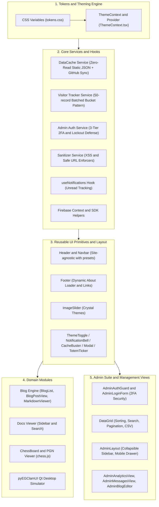

# EG-Web-Core Library

**EG-Web-Core Library** (`eg-web-core`) is the shared React component library, design token engine, client services framework, and administrative management suite powering the EG web ecosystem:
- [`eg1.in`](../eg1.in) — Main portal & product catalog
- [`mchess.eg1.in`](../mchess.eg1.in) — Multiplayer and engine chess platform
- [`av.eg1.in`](../av.eg1.in) — pyEGClamUI antivirus suite & documentation

---

## 🚀 Key Architectural Highlights

1. **Website-Agnostic with Neutral Defaults (Critical Rule 5)**:
   - Zero hardcoded branding, domain names, emails, or site-exclusive routes in the core library.
   - All branding, whitelist emails, collections, and layouts are fully configurable via props.
2. **Hardened Three-Tier Admin Security**:
   - Google OAuth with strict email whitelist verification.
   - 16-Digit salted SHA-256 PIN challenge ($10^{16}$ combinations) computed via the standard browser Web Crypto API.
   - Automated IP brute-force lockout defense (24-hour block upon 3 consecutive failures) and paginated audit logs.
3. **High-Efficiency Cloud Quota Patterns**:
   - **DataCache Service**: Zero-read catalog caching via static JSON and client `localStorage`.
   - **Batched Bucket Telemetry**: Groups 50 visitor sessions into a single document, reducing Firestore write quota consumption by 98%.
4. **Rich Accessible Design System**:
   - Zero external CSS framework dependencies (Vanilla CSS + Design Tokens).
   - Glassmorphism, smooth micro-interactions, dark/light theme switching, and responsive mobile drawers.

---

## 🏗️ Architecture & Component Flow



---

## 📦 Detailed Documentation Guides

Full documentation with architecture diagrams, API tables, and code snippets:

| Guide | Description & Scope | Source Link |
| :--- | :--- | :--- |
| **[Admin Suite Documentation](./docs/admin-suite.md)** | 3-tier auth, lockout defense, generic DataGrid, analytics, inquiries & blog editor | [`./docs/admin-suite.md`](./docs/admin-suite.md) |
| **[Theming & Design Tokens](./docs/theming-and-tokens.md)** | Unified design system tokens, CSS variables & theme provider | [`./docs/theming-and-tokens.md`](./docs/theming-and-tokens.md) |
| **[Core Hooks & Services](./docs/hooks-and-services.md)** | DataCache, telemetry buckets, 2FA admin auth & sanitization | [`./docs/hooks-and-services.md`](./docs/hooks-and-services.md) |
| **[Layout Components](./docs/layout-components.md)** | Universal header, dynamic footer, slider, and containers | [`./docs/layout-components.md`](./docs/layout-components.md) |
| **[UI Primitives](./docs/ui-primitives.md)** | Buttons, badges, dialog modals, smart scroll button, consent controls, procedural SVG icons | [`./docs/ui-primitives.md`](./docs/ui-primitives.md) |
| **[Domain Feature Modules](./docs/domain-modules.md)** | Blog engine, Markdown viewer, math CAPTCHA contact form, product showcase & Qt desktop simulator | [`./docs/domain-modules.md`](./docs/domain-modules.md) |

---

## ⚡ Quickstart

### 1. Installation
In consumer applications (e.g. `eg1.in`):
```bash
npm install ../eg-web-core
```

### 2. Import Styles
Import the compiled CSS tokens at your application root:
```tsx
import 'eg-web-core/style.css';
```

### 3. Usage Example (App Shell + Admin Route)

```tsx
import React from 'react';
import {
  ThemeProvider,
  Header,
  Footer,
  AdminAuthGuard,
  AdminLayout,
  AdminAnalyticsView,
} from 'eg-web-core';

export function AdminPortal() {
  return (
    <ThemeProvider defaultTheme="light-gray">
      <AdminAuthGuard
        authConfig={{
          allowedEmails: ['admin@example.com'],
          pinSalt: 'YOUR_PIN_SALT_SECRET',
        }}
      >
        {({ user, logout }) => (
          <AdminLayout
            brandTitle="Universal Admin Portal"
            navItems={[
              { id: 'analytics', label: 'Visitor Telemetry', icon: '📊' },
              { id: 'messages', label: 'Inquiries', icon: '✉️' },
            ]}
            user={user}
            onLogout={logout}
          >
            <AdminAnalyticsView collectionName="visitor_analytics" />
          </AdminLayout>
        )}
      </AdminAuthGuard>
    </ThemeProvider>
  );
}
```

---

## 🛠️ Build, Publishing & Showcase Deployment

`eg-web-core` features a **Dual-Target Architecture**:

### 1. Core Library Bundle for npm Registry
```bash
# Build the production library bundle (ESM, CJS, TypeScript Types, CSS) into dist/
npm run build:lib
# or: npm run build

# Verify packaging contents before publishing
npm pack --dry-run

# Publish to the npm registry
npm publish --access public
```

### 2. Showcase Web Portal for `web-core.eg1.in`
```bash
# Start the interactive development playground
npm run dev

# Build the interactive showcase portal (dist-site/)
npm run build:site

# Preview the built showcase portal locally
npm run preview:site

# Deploy directly to Firebase Hosting (web-core.eg1.in)
firebase deploy --only hosting
```

### 3. Automated GitHub Actions CI/CD Pipelines
- **Showcase Deployment** (`.github/workflows/deploy-showcase.yml`): Runs quality checks, builds `dist-site/`, and automatically deploys to `https://web-core.eg1.in/` on every merge to `main`.
- **npm Registry Release** (`.github/workflows/publish-npm.yml`): Automatically builds `dist/` and runs `npm publish` whenever a new Git release tag (e.g. `v1.0.0`) is published.

---

## 🌐 Consumer Web Portals & Documentation Hubs

| Consumer Portal | Documentation Hub | Key Features Consumed |
| :--- | :--- | :--- |
| **EG1 Portal** | [`../eg1.in/docs/README.md`](../eg1.in/docs/README.md) | `Header` (eg1), `Footer` (eg1), `MarkdownViewer` (47 blogs), `AdminSuite` (2FA), `DataCache`, `ImageSlider` |
| **Marwadi Chess** | [`../mchess.eg1.in/docs/README.md`](../mchess.eg1.in/docs/README.md) | `Header` (mchess), `Footer` (mchess), `ThemeProvider` (dark), `AdminSuite` (2FA), `VisitorTracker` |
| **pyEGClamUI** | [`../av.eg1.in/docs/README.md`](../av.eg1.in/docs/README.md) | `Header` (av), `Footer` (av), `DocsViewer` (17 guides), `MarkdownViewer`, `VisitorTracker` |

---

## 📄 License

This project is open-source software licensed under the **[MIT License](./LICENSE)**.  
Copyright (c) 2026 EG1.

