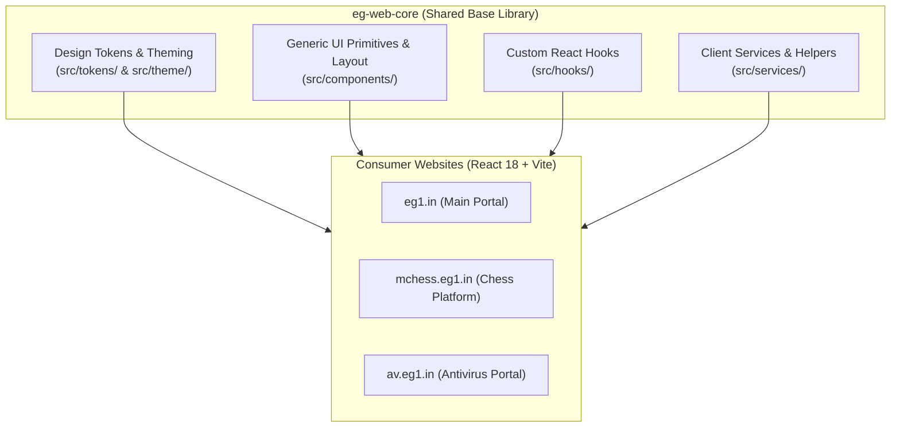
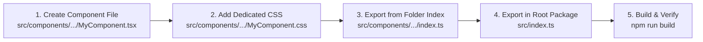
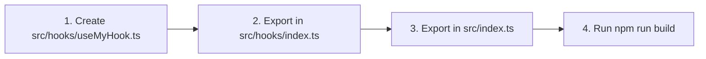
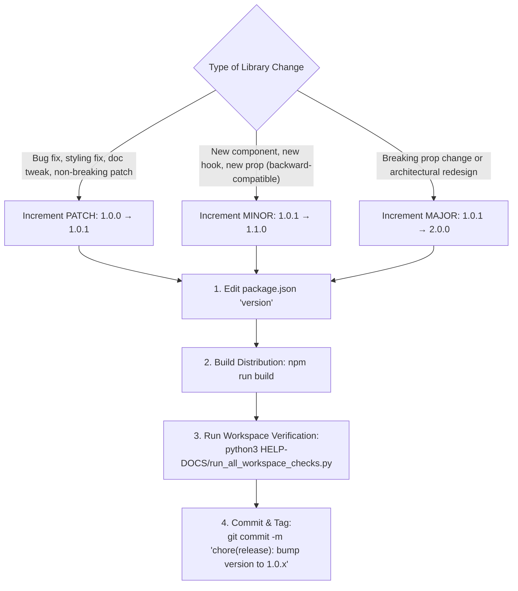

# EG-Web-Core Developer & Operations Manual

This guide provides step-by-step procedures to develop, extend, maintain, and package the **`eg-web-core`** shared library without needing to inspect the underlying source code line-by-line.

---

## 🏗️ 1. Architecture & Core Principles

`eg-web-core` is the foundational React 18 + TypeScript component library, design token engine, and services framework consumed by all EG1 websites (`eg1.in`, `mchess.eg1.in`, `av.eg1.in`).



### Critical Architectural Directives:
1. **Website-Agnostic with Neutral Defaults (Critical Rule 5)**:
   - **Never hardcode site-specific names, titles, personal bylines, domains, or site-exclusive routes** inside `eg-web-core`.
   - All branding, whitelists, routes, and layout variations must be configured via props or dynamic registration methods (e.g., `DataCache.registerAppSlugs()`).
2. **Backward Compatibility & Non-Regression (Critical Rule 6)**:
   - Props, function signatures, defaults, and visual behaviors previously relied upon must never be broken or degraded.
   - Always run the master workspace suite after changes to ensure zero consumer regressions.

---

## 🛠️ 2. Step-by-Step Procedure: Add a New UI Component

Follow this checklist to create and export a new reusable component:



### Step 1: Create Component & Styles
1. Choose the proper category folder under `src/components/`:
   - `common/` for universal primitives (Buttons, Badges, Modals, Spinners, Icons)
   - `layout/` for page structural shells (Container, Header, Footer, Section)
   - `content/` for information display (Cards, Grids, Markdown, Accordions)
   - `admin/` for administrative controls (Auth wrappers, Tables, Audit logs)
2. Create `MyComponent.tsx`:
   ```tsx
   import React from 'react';
   import './MyComponent.css';

   export interface MyComponentProps {
     title: string;
     variant?: 'primary' | 'secondary';
     children?: React.ReactNode;
     className?: string;
     style?: React.CSSProperties;
   }

   /**
    * Generic reusable component with neutral defaults.
    *
    * @example
    * ```tsx
    * <MyComponent title="Dashboard" variant="primary">Content</MyComponent>
    * ```
    */
   export const MyComponent: React.FC<MyComponentProps> = ({
     title,
     variant = 'primary',
     children,
     className = '',
     style = {},
   }) => {
     return (
       <div className={`eg-my-component eg-my-component--${variant} ${className}`} style={style}>
         <h3 className="eg-my-component__title">{title}</h3>
         <div className="eg-my-component__body">{children}</div>
       </div>
     );
   };
   ```

3. Create `MyComponent.css` using CSS custom properties (design tokens):
   ```css
   .eg-my-component {
     background: var(--eg-bg-surface, #ffffff);
     border: 1px solid var(--eg-border-subtle, rgba(0, 0, 0, 0.1));
     border-radius: var(--eg-radius-md, 8px);
     padding: 16px;
     transition: background var(--eg-transition-normal, 200ms);
   }

   .eg-my-component__title {
     color: var(--eg-text-primary, #0f172a);
     margin: 0 0 8px 0;
   }
   ```

### Step 2: Export from Module and Root Index
1. In `src/components/<category>/index.ts`:
   ```ts
   export * from './MyComponent';
   ```
2. In `src/index.ts`:
   ```ts
   export * from './components/<category>/MyComponent';
   ```

---

## 🪝 3. Step-by-Step Procedure: Add a Custom Hook



1. Create `src/hooks/useMyHook.ts`:
   ```ts
   import { useState, useEffect } from 'react';

   export interface MyHookOptions {
     storageKey?: string;
     initialValue?: boolean;
   }

   export function useMyHook(options: MyHookOptions = {}) {
     const { storageKey = 'eg_default_key', initialValue = false } = options;
     const [state, setState] = useState<boolean>(initialValue);

     useEffect(() => {
       try {
         const saved = localStorage.getItem(storageKey);
         if (saved !== null) setState(JSON.parse(saved));
       } catch {}
     }, [storageKey]);

     return { state, setState };
   }
   ```
2. Export in `src/hooks/index.ts` and `src/index.ts`.

---

## 🛡️ 4. Step-by-Step Procedure: Add or Modify a Client Service

Core services reside in `src/services/`:
- `DataCache.ts`: High-speed offline caching for apps and blog articles.
- `sanitizer.ts`: XSS prevention and safe URL verification.
- `contactService.ts`: Anti-spam Math CAPTCHA and inquiry submissions.
- `visitorTracker.ts`: Batched bucket telemetry writer (50 records per document).

### Registration Standards:
When a consumer requires custom storage prefixes or catalog identifiers, **never hardcode them into the service file**. Instead, expose registration helpers:
```ts
// Good (Generic Service with Registration)
export class DataCache {
  private static registeredSlugs: string[] = [];
  public static registerAppSlugs(slugs: string[]): void {
    this.registeredSlugs = [...new Set([...this.registeredSlugs, ...slugs])];
  }
}
```
Consumers register their specific identifiers at bootstrap in `src/App.tsx`.

---

## 🎨 5. Theming & Design Tokens Guide

The design token system is declared in `src/tokens/tokens.css` and managed via `ThemeProvider` (`src/theme/ThemeContext.tsx`).

### Standard CSS Variable Tokens:

| Token Name | Light Theme Default | Dark Theme Default | Purpose |
|---|---|---|---|
| `--eg-bg-canvas` | `#f8fafc` | `#0b0f19` | Main page background |
| `--eg-bg-surface` | `#ffffff` | `#131b2e` | Cards, modals, containers |
| `--eg-bg-subtle` | `rgba(0,0,0,0.04)` | `rgba(255,255,255,0.05)` | Chips, inactive tabs |
| `--eg-text-primary` | `#0f172a` | `#f1f5f9` | High-contrast headers & titles |
| `--eg-text-secondary` | `#475569` | `#94a3b8` | Body copy and descriptions |
| `--eg-border-subtle` | `rgba(0,0,0,0.08)` | `rgba(255,255,255,0.1)` | Subtle dividers and card borders |
| `--eg-color-primary` | `#b8860b` | `#eab308` | Primary accent color |

---

## 🚀 6. Build, Testing & Verification Commands

All development commands must be executed from the `eg-web-core/` directory:

```bash
# 1. Type-check TypeScript code
npm run typecheck

# 2. Run ESLint code checks
npm run lint

# 3. Build production distribution bundle (dist/index.js & dist/index.cjs)
npm run build

# 4. Run automated integrity test suite
python3 automation-scripts/run_all_checks.py
```

### Cross-Consumer Verification:
After modifying `eg-web-core/`, immediately verify all consumer web portals:
```bash
# Run master suite from workspace root
python3 HELP-DOCS/run_all_workspace_checks.py
```

---

## 🏷️ 7. How to Bump & Release a New Library Version

`eg-web-core` follows [Semantic Versioning (SemVer)](https://semver.org/): `MAJOR.MINOR.PATCH`.



### Step-by-Step Procedure:

1. **Decide Version Increment**:
   - **Patch (`1.0.x`)**: Bug fixes, styling refinements, CSS adjustments, internal documentation.
   - **Minor (`1.x.0`)**: New components, new hooks, additive optional props, backward-compatible features.
   - **Major (`x.0.0`)**: Breaking API changes (strictly avoided per Critical Rule 6).

2. **Update `package.json`**:
   Open [`package.json`](../package.json) and update the `"version"` field:
   ```json
   {
     "name": "eg-web-core",
     "version": "1.0.1",
     ...
   }
   ```

3. **Rebuild Distribution Artifacts**:
   Run build to regenerate the `dist/` directory:
   ```bash
   npm run build
   ```

4. **Verify All Downstream Consumers**:
   Ensure no consumer applications (`eg1.in`, `mchess.eg1.in`, `av.eg1.in`) break:
   ```bash
   python3 ../HELP-DOCS/run_all_workspace_checks.py
   ```

5. **Commit the Version Bump**:
   ```bash
   git add package.json dist/
   git commit -m "chore(release): bump eg-web-core to 1.0.1"
   ```


