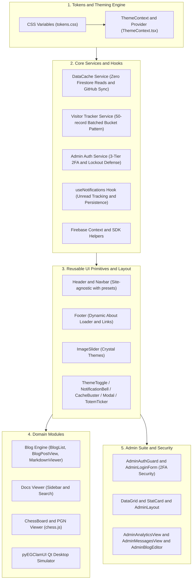

# EG-Web-Core Library — Developer Documentation & Guide

The **EG-Web-Core Library** (`eg-web-core`) provides shared UI components, design tokens, hooks, and client services across the EG1 web ecosystem ([`eg1.in`](../../eg1.in), [`mchess.eg1.in`](../../mchess.eg1.in), and [`av.eg1.in`](../../av.eg1.in)) as reusable, type-safe React 18+ components.

---

## 🏗️ Architecture & Component Flow



---

## 📦 Documentation Directory

| Document | Focus & Scope | Key Modules / Components Covered |
| :--- | :--- | :--- |
| **[Admin Suite](./admin-suite.md)** | Hardened 2FA, lockout defense, generic DataGrid, analytics, inquiries & blog editor | [`adminAuthService.ts`](../src/services/adminAuthService.ts), [`DataGrid.tsx`](../src/components/admin/DataGrid.tsx), [`AdminLayout.tsx`](../src/components/admin/AdminLayout.tsx), [`AdminAnalyticsView.tsx`](../src/components/admin/AdminAnalyticsView.tsx), [`AdminMessagesView.tsx`](../src/components/admin/AdminMessagesView.tsx), [`AdminBlogEditor.tsx`](../src/components/admin/AdminBlogEditor.tsx) |
| **[Theming & Design Tokens](./theming-and-tokens.md)** | Unified design system & themes | [`tokens.css`](../src/tokens/tokens.css), [`ThemeContext.tsx`](../src/theme/ThemeContext.tsx), `useTheme()` |
| **[Core Hooks & Services](./hooks-and-services.md)** | Data caching, telemetry, notifications, 2FA admin auth | [`DataCache.ts`](../src/services/DataCache.ts), [`visitorTracker.ts`](../src/services/visitorTracker.ts), [`adminAuthService.ts`](../src/services/adminAuthService.ts), [`useAdminAuth.ts`](../src/hooks/useAdminAuth.ts), [`useNotifications.ts`](../src/hooks/useNotifications.ts) |
| **[Layout Components](./layout-components.md)** | Navigation, headers, footers, containers | [`Header.tsx`](../src/components/layout/Header.tsx), [`Footer.tsx`](../src/components/layout/Footer.tsx), [`ImageSlider.tsx`](../src/components/layout/ImageSlider.tsx), [`Container.tsx`](../src/components/layout/Container.tsx) |
| **[UI Primitives](./ui-primitives.md)** | Buttons, badges, dialog modals, smart scroll button, consent controls, procedural SVG icons | [`Modal.tsx`](../src/components/common/Modal.tsx), [`SmartScrollButton.tsx`](../src/components/common/SmartScrollButton.tsx), [`ConsentBanner.tsx`](../src/components/common/ConsentBanner.tsx), [`ConsentControl.tsx`](../src/components/common/ConsentControl.tsx), [`Logo.tsx`](../src/components/common/Logo.tsx), [`SocialIcons.tsx`](../src/components/common/SocialIcons.tsx), [`ThemeToggle.tsx`](../src/components/common/ThemeToggle.tsx), [`NotificationBell.tsx`](../src/components/common/NotificationBell.tsx), [`CacheBuster.tsx`](../src/components/common/CacheBuster.tsx), [`TotemTicker.tsx`](../src/components/common/TotemTicker.tsx), [`Button.tsx`](../src/components/common/Button.tsx), [`Badge.tsx`](../src/components/common/Badge.tsx) |
| **[Domain Feature Modules](./domain-modules.md)** | Blog engine, Markdown viewer, math CAPTCHA contact form, product showcase & Qt desktop simulator | [`BlogList.tsx`](../src/components/content/BlogList.tsx), [`MarkdownViewer.tsx`](../src/components/content/MarkdownViewer.tsx), [`ContactForm.tsx`](../src/components/content/ContactForm.tsx), [`ProductGrid.tsx`](../src/components/content/ProductGrid.tsx), [`ProductDetail.tsx`](../src/components/content/ProductDetail.tsx), [`UpdatesTimeline.tsx`](../src/components/content/UpdatesTimeline.tsx), [`DocsViewer.tsx`](../src/components/content/DocsViewer.tsx), [`DesktopPreviewSimulator.tsx`](../src/components/content/DesktopPreviewSimulator.tsx) |

---

## ⚡ Quickstart & Installation

### 1. Installation in Consumer Projects
In any sibling consumer project (such as `eg1.in`):
```bash
npm install ../eg-web-core
```

### 2. Import Styles
Import the compiled CSS variables and animations at your root entry point (e.g. `main.tsx` or `_app.tsx`):
```tsx
import 'eg-web-core/style.css';
```

### 3. Basic Application Shell Example
```tsx
import React from 'react';
import {
  ThemeProvider,
  Header,
  Footer,
  Container,
  ImageSlider,
  ConsentBanner,
} from 'eg-web-core';

export function App() {
  return (
    <ThemeProvider defaultTheme="light-gray">
      {/* Universal header supporting 'eg1', 'mchess', or 'clamui' */}
      <Header preset="eg1" />

      <main>
        <Container>
          <ImageSlider />
          {/* Your page content */}
        </Container>
      </main>

      <Footer preset="eg1" />
      <ConsentBanner />
    </ThemeProvider>
  );
}
```

---

## 🛠️ Build & Verification Commands

```bash
# Inside eg-web-core/
npm install          # Install dependencies
npm run build        # Build library bundle (ESM, CJS, Types, CSS)
npm run dev          # Launch interactive playground at http://localhost:5173
```

---

## 🌐 Consumer Web Portals & Documentation Hubs

The following modernized portals consume `eg-web-core`:

| Consumer Portal | Documentation Hub | Core Features Consumed |
| :--- | :--- | :--- |
| **EG1 Portal** | [`../../eg1.in/docs/README.md`](../../eg1.in/docs/README.md) | `Header` (eg1), `Footer` (eg1), `MarkdownViewer` (47 blogs), `AdminSuite` (2FA), `DataCache`, `ImageSlider` |
| **Marwadi Chess** | [`../../mchess.eg1.in/docs/README.md`](../../mchess.eg1.in/docs/README.md) | `Header` (mchess), `Footer` (mchess), `ThemeProvider` (dark), `AdminSuite` (2FA), `VisitorTracker` |
| **pyEGClamUI** | [`../../av.eg1.in/docs/README.md`](../../av.eg1.in/docs/README.md) | `Header` (av), `Footer` (av), `DocsViewer` (17 guides), `MarkdownViewer`, `VisitorTracker` |

