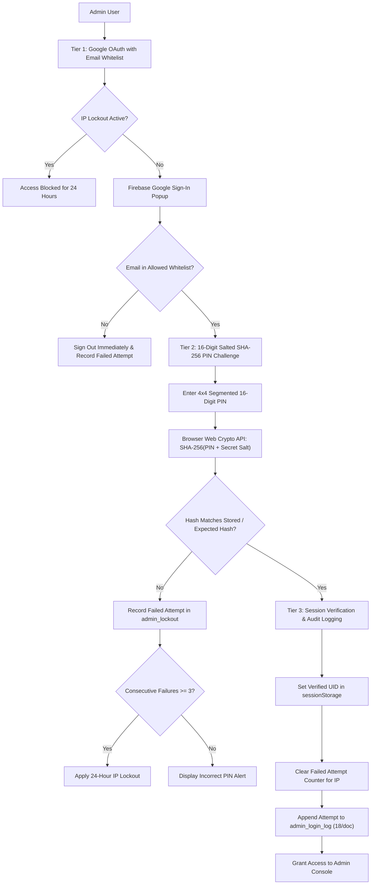

# Admin Suite — Security, Controls & Management Views

The **Admin Suite** in `eg-web-core` provides a hardened, three-tier administrative infrastructure, generic data exploration tables, responsive layout shells, and management views for visitor analytics, contact inquiries, and blog article authoring.

---

## 🔗 Source Files

| Component / Service | File Path | Focus |
| :--- | :--- | :--- |
| **Admin Auth Service** | [`../src/services/adminAuthService.ts`](../src/services/adminAuthService.ts) | 3-tier auth, SHA-256 PIN, brute-force lockout, audit logs |
| **Firebase Auth Loader** | [`../src/services/firebase.ts`](../src/services/firebase.ts) | Dynamic Firebase Auth compat SDK loading & helpers |
| **useAdminAuth Hook** | [`../src/hooks/useAdminAuth.ts`](../src/hooks/useAdminAuth.ts) | Reactive 2FA authentication state management hook |
| **AdminLoginForm** | [`../src/components/admin/AdminLoginForm.tsx`](../src/components/admin/AdminLoginForm.tsx) | 2-step card: Google OAuth + 4x4 segmented 16-digit PIN |
| **AdminAuthGuard** | [`../src/components/admin/AdminAuthGuard.tsx`](../src/components/admin/AdminAuthGuard.tsx) | Route guard wrapper for protected administration areas |
| **DataGrid** | [`../src/components/admin/DataGrid.tsx`](../src/components/admin/DataGrid.tsx) | Generic data table: sorting, live search, pagination, CSV |
| **StatCard** | [`../src/components/admin/StatCard.tsx`](../src/components/admin/StatCard.tsx) | KPI metric card with icons, accents, and trend badges |
| **AdminLayout** | [`../src/components/admin/AdminLayout.tsx`](../src/components/admin/AdminLayout.tsx) | Shell: collapsible sidebar, mobile drawer, theme toggle |
| **AdminAnalyticsView** | [`../src/components/admin/AdminAnalyticsView.tsx`](../src/components/admin/AdminAnalyticsView.tsx) | Visitor telemetry, 50-record bucket pages, detail modal |
| **AdminMessagesView** | [`../src/components/admin/AdminMessagesView.tsx`](../src/components/admin/AdminMessagesView.tsx) | Contact inquiries, quick mailto reply, safe deletion |
| **AdminBlogEditor** | [`../src/components/admin/AdminBlogEditor.tsx`](../src/components/admin/AdminBlogEditor.tsx) | Markdown editor, live MarkdownViewer preview, YAML generator |
| **Admin Suite Barrel** | [`../src/components/admin/index.ts`](../src/components/admin/index.ts) | Re-exports all components and type interfaces |

---

## 🛡️ Three-Tier Security Defense Model

The administrative suite implements a three-tier defense model designed to protect administrative panels without requiring heavy custom server infrastructure:



### 1. Tier 1: Google OAuth Whitelisting
- Validates identity against Google identity services (`signInWithPopup`).
- Enforces session persistence so closing the browser tab terminates the authenticated Google token.
- Matches against the configurable `allowedEmails: string[]` array. Any unauthorized Google account is immediately signed out and logged as `fail_unauthorized`.

### 2. Tier 2: 16-Digit Salted SHA-256 Security PIN
- The 16-digit numeric PIN yields $10^{16}$ possible combinations. At a brute-force speed of 1 billion hashes/sec, an exhaustive search requires over 115 days.
- Uses the standard browser **Web Crypto API** (`crypto.subtle.digest('SHA-256', ...)`).
- Validates either against a locally injected `expectedPinHash` or queries Firestore `admin_security/<uid>` for the user's `pinHash`.

### 3. Tier 3: IP Brute-Force Lockout & Audit Trail
- Client public IP is resolved asynchronously via `api.ipify.org` (with a 3-second abort timeout).
- Consecutive failed attempts are recorded in Firestore `admin_lockout/<sanitized_ip>`.
- Reaching 3 consecutive failed attempts applies a **24-hour lockout**, blocking both Google sign-in and PIN verification for that IP.
- All successful and failed authentication events are recorded in `admin_login_log` using the batched 18-entries-per-document pattern (`meta` + `page_N`).

---

## 🧩 Component Catalog & Usages

### 1. `AdminLoginForm`
A 2-step card supporting Google Sign-In and 4x4 segmented 16-digit PIN entry with auto-advancing focus, paste distribution, mask toggle, and lockout warning countdown.

```tsx
import React from 'react';
import { AdminLoginForm } from 'eg-web-core';

export function LoginPage() {
  return (
    <AdminLoginForm
      title="Admin Portal"
      subtitle="Authorized personnel only"
      allowedEmails={['admin@example.com']}
      pinConfig={{
        salt: 'YOUR_PIN_SALT_SECRET',
        // Optional pre-hashed value for client-side or offline verification:
        expectedPinHash: 'e3b0c44298fc1c149afbf4c8996fb92427ae41e4649b934ca495991b7852b855',
      }}
      onSuccess={(user) => {
        console.log('Authenticated admin:', user.email);
      }}
    />
  );
}
```

#### Props Reference: `AdminLoginFormProps`
| Prop | Type | Default | Description |
| :--- | :--- | :--- | :--- |
| `title` | `string` | `'Admin Portal'` | Card title |
| `subtitle` | `string` | `'Sign in with your authorized administrator credentials'` | Explanatory note |
| `logo` | `React.ReactNode` | `LockIcon` | Optional brand icon or element |
| `allowedEmails` | `string[]` | `[]` | Whitelisted Google email accounts |
| `pinConfig` | `AdminPinConfig` | `{}` | Secret salt, expected hash, and length |
| `authConfig` | `AdminAuthConfig` | `{}` | Full authentication and collection settings |
| `onSuccess` | `(user: AdminUser) => void` | `undefined` | Callback fired upon successful 2FA unlock |

---

### 2. `AdminAuthGuard`
Protects admin views or routes. Renders `AdminLoginForm` when unauthenticated, a loading spinner during session resolution, and `children` once verified.

```tsx
import React from 'react';
import { AdminAuthGuard } from 'eg-web-core';
import { AdminDashboard } from './AdminDashboard';

export function ProtectedAdminRoute() {
  return (
    <AdminAuthGuard
      authConfig={{
        allowedEmails: ['admin@example.com'],
        pinSalt: 'YOUR_PIN_SALT_SECRET',
      }}
    >
      {({ user, logout }) => (
        <AdminDashboard user={user} onLogout={logout} />
      )}
    </AdminAuthGuard>
  );
}
```

---

### 3. `DataGrid<T>`
Generic, high-performance table component supporting multi-type sorting, real-time filtering, page sizing, and one-click CSV export.

```tsx
import React from 'react';
import { DataGrid, DataGridColumn } from 'eg-web-core';

interface ProductItem {
  id: string;
  name: string;
  downloads: number;
  lastUpdated: string;
  serverIp: string;
}

const columns: DataGridColumn<ProductItem>[] = [
  { key: 'name', label: 'Product Name', sortType: 'string' },
  { key: 'downloads', label: 'Downloads', sortType: 'number', align: 'right' },
  { key: 'lastUpdated', label: 'Updated', sortType: 'date' },
  { key: 'serverIp', label: 'Mirror IP', sortType: 'ip' },
];

export function ProductsTable({ data }: { data: ProductItem[] }) {
  return (
    <DataGrid<ProductItem>
      data={data}
      columns={columns}
      keyExtractor={(item) => item.id}
      defaultPageSize={15}
      pageSizeOptions={[10, 15, 25, 50]}
      exportable={true}
      exportFileName="products_inventory.csv"
      searchPlaceholder="Filter products..."
    />
  );
}
```

#### Props Reference: `DataGridProps<T>`
| Prop | Type | Default | Description |
| :--- | :--- | :--- | :--- |
| `data` | `T[]` | **Required** | Data records array |
| `columns` | `DataGridColumn<T>[]` | **Required** | Column definitions |
| `keyExtractor` | `(row: T, index: number) => string \| number` | Index | Unique row key extractor |
| `defaultPageSize` | `number` | `15` | Default rows per page |
| `pageSizeOptions` | `number[]` | `[10, 15, 25, 50, 100]` | Available page size choices |
| `searchable` | `boolean` | `true` | Enables real-time search input |
| `searchKeys` | `string[]` | All columns | Specific keys to inspect for matches |
| `exportable` | `boolean` | `true` | Shows CSV Export button |
| `exportFileName` | `string` | `'export.csv'` | Downloaded file name |
| `loading` | `boolean` | `false` | Displays table loading skeleton |
| `toolbarSlot` | `React.ReactNode` | `undefined` | Custom buttons or filters next to search |
| `onRowClick` | `(row: T) => void` | `undefined` | Row selection callback |

---

### 4. `StatCard`
Metric summary card displaying an icon badge, title, formatted value, subtitle, and directional trend indicators (`up`, `down`, `neutral`).

```tsx
import React from 'react';
import { StatCard } from 'eg-web-core';

export function DashboardMetrics() {
  return (
    <div style={{ display: 'grid', gridTemplateColumns: 'repeat(3, 1fr)', gap: '16px' }}>
      <StatCard
        title="Total Inquiries"
        value={1248}
        subtitle="Since platform launch"
        trend={{ value: '12% this month', direction: 'up' }}
      />
      <StatCard
        title="Daily Visitors"
        value={432}
        subtitle="Unique IPs recorded"
        icon={<span>🌐</span>}
        iconBgColor="rgba(56, 189, 248, 0.15)"
        iconColor="#38bdf8"
      />
    </div>
  );
}
```

---

### 5. `AdminLayout`
The master layout shell for administrative consoles. Features a collapsible sidebar, slide-out mobile drawer, sticky header, theme toggle, and user profile pill with logout action.

```tsx
import React, { useState } from 'react';
import { AdminLayout, AdminNavItem } from 'eg-web-core';

const navItems: AdminNavItem[] = [
  { id: 'analytics', label: 'Analytics', icon: '📊', badge: 'Live' },
  { id: 'messages', label: 'Messages', icon: '✉️', badge: 3 },
  { id: 'blog', label: 'Blog Editor', icon: '📝' },
];

export function PortalShell({ user, onLogout }: { user: any; onLogout: () => void }) {
  const [activeTab, setActiveTab] = useState('analytics');

  return (
    <AdminLayout
      brandTitle="EG1 Portal"
      brandSubtitle="Admin Suite v2.0"
      navItems={navItems}
      activeNavId={activeTab}
      onNavSelect={setActiveTab}
      user={user}
      onLogout={onLogout}
    >
      {activeTab === 'analytics' && <div>Analytics Content</div>}
      {activeTab === 'messages' && <div>Messages Content</div>}
      {activeTab === 'blog' && <div>Blog Content</div>}
    </AdminLayout>
  );
}
```

---

### 6. `AdminAnalyticsView`
Complete visitor telemetry dashboard reading from the 50-record bucket documents in Cloud Firestore (`visitor_analytics/meta` and `visitor_analytics/page_N`).

```tsx
import React from 'react';
import { AdminAnalyticsView } from 'eg-web-core';

export function AnalyticsSection() {
  return (
    <AdminAnalyticsView
      collectionName="visitor_analytics"
      domains={['All Domains', 'eg1.in', 'mchess.eg1.in', 'av.eg1.in']}
    />
  );
}
```
- **Bucket Pagination**: Supports navigating through historical buckets (`Bucket 1 of 5`) with 1 single document read per page.
- **16-Field Inspection Modal**: Inspects IP, city, region, country, postal code, ISP/organization, timezone, OS, browser, screen resolution, language, and raw JSON payload.

---

### 7. `AdminMessagesView`
Complete contact inquiries management console reading from Firestore `messages` collection.

```tsx
import React from 'react';
import { AdminMessagesView } from 'eg-web-core';

export function InquiriesSection() {
  return (
    <AdminMessagesView
      collectionName="messages"
      title="Customer Inquiries"
    />
  );
}
```
- **Quick Mailto Reply**: 1-click reply button opening the user's mail client with pre-filled subject line.
- **Safe Deletion**: Two-step confirmation modal preventing accidental deletions.

---

### 8. `AdminBlogEditor`
Markdown article authoring tool and YAML frontmatter builder.

```tsx
import React from 'react';
import { AdminBlogEditor } from 'eg-web-core';

export function BlogEditorPage() {
  return (
    <AdminBlogEditor
      categories={['Tutorial', 'Announcements', 'Architecture', 'Security']}
      defaultAuthor="EG1 Engineering"
      onSave={async (fullMarkdown, metadata) => {
        console.log('Generated Markdown document:', fullMarkdown);
        console.log('Metadata:', metadata);
        // Persist to GitHub repository, backend API, or Firestore
      }}
    />
  );
}
```
- **Auto-generating Slug**: Transforms titles into clean URL slugs with an override unlock button.
- **Interactive Tag Chips**: Adds tag chips on Enter or comma; deletes via backspace or click.
- **Split Preview**: Displays live preview rendered by `<MarkdownViewer />`.
- **Export**: One-click "Copy Markdown" and "Download .md" buttons.

---

## ⚡ React Hook: `useAdminAuth`

The `useAdminAuth` hook encapsulates all state and actions required to build custom administrative experiences:

```tsx
import { useAdminAuth } from 'eg-web-core';

const {
  user,              // AdminUser | null (Google profile)
  isPinVerified,     // boolean (true if 16-digit PIN was verified in current session)
  isAuthenticated,   // boolean (user && isPinVerified)
  isLoading,         // boolean (loading state during auth or verification)
  error,             // string | null (user-facing error message)
  lockout,           // AdminLockoutStatus { locked, unlocksAt, failCount, hoursRemaining }
  clientIP,          // string (detected client IPv4)
  loginWithGoogle,   // () => Promise<AdminUser | null>
  verifyPin,         // (pin: string) => Promise<boolean>
  logout,            // () => Promise<void>
  resetPinPrompt,    // () => void (re-triggers PIN entry without signing out of Google)
  refreshLockout,    // () => Promise<void>
  clearError,        // () => void
} = useAdminAuth({
  allowedEmails: ['admin@example.com'],
  pinSalt: 'YOUR_PIN_SALT_SECRET',
});
```
