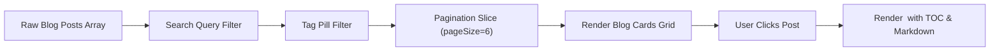
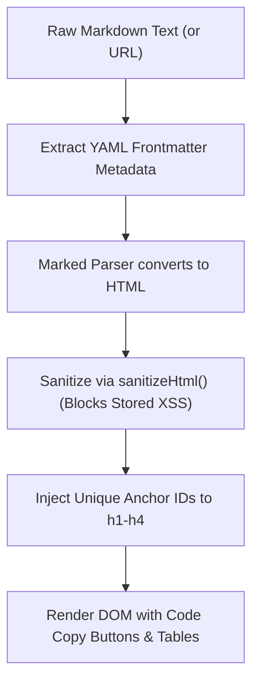
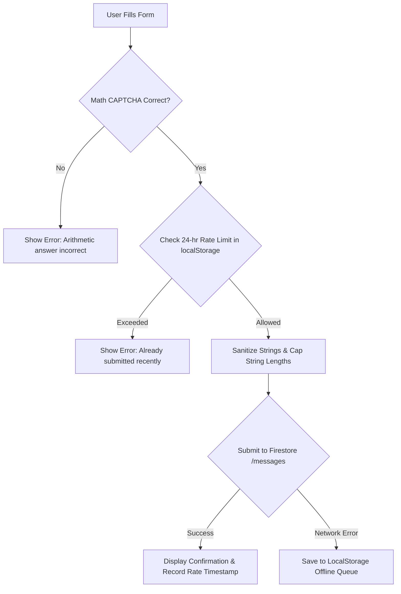

# Domain Feature Modules Documentation

This document covers the domain-specific application modules, blog engine, Markdown renderers, contact systems, product showcases, and interactive application simulators provided by `eg-web-core`.

---

## 🔗 Source Components Directory Links

| Component | File Path | Focus |
| :--- | :--- | :--- |
| **Blog Engine** | [`../src/components/content/BlogList.tsx`](../src/components/content/BlogList.tsx) | Blog grid, search, tag filters, and article reader |
| **Markdown Viewer** | [`../src/components/content/MarkdownViewer.tsx`](../src/components/content/MarkdownViewer.tsx) | Sanitized Markdown rendering, code copy, auto-headings |
| **Contact Form** | [`../src/components/content/ContactForm.tsx`](../src/components/content/ContactForm.tsx) | Math CAPTCHA, 24-hr rate limit, Firestore `/messages` |
| **Product Showcase** | [`../src/components/content/ProductGrid.tsx`](../src/components/content/ProductGrid.tsx) | Software cards grid with dynamic GitHub version sync |
| **Product Detail** | [`../src/components/content/ProductDetail.tsx`](../src/components/content/ProductDetail.tsx) | Multi-OS downloads, features list, screenshot viewer |
| **Updates Timeline** | [`../src/components/content/UpdatesTimeline.tsx`](../src/components/content/UpdatesTimeline.tsx) | Chronological release changelog with category badges |
| **Docs Viewer** | [`../src/components/content/DocsViewer.tsx`](../src/components/content/DocsViewer.tsx) | Technical documentation browser with sidebar and search |
| **Desktop App Simulator** | [`../src/components/content/DesktopPreviewSimulator.tsx`](../src/components/content/DesktopPreviewSimulator.tsx) | Interactive PySide6 Qt desktop GUI antivirus simulator |

---

## 1. 📝 Blog Engine (`<BlogList />`, `<BlogPostView />`, `<BlogCard />`)

A client-side blog engine with search filtering, category tag pills, pagination, reading time calculation, smooth table of contents heading jumps, and social sharing.



### 📋 Props Reference: `BlogListProps`
| Prop | Type | Default | Description |
| :--- | :--- | :--- | :--- |
| `posts` | `BlogPostItem[]` | **Required** | Array of blog post objects |
| `pageSize` | `number` | `6` | Number of articles displayed per page |
| `onSelectPost` | `(post: BlogPostItem) => void` | `undefined` | Callback fired when user clicks an article card |
| `activeTag` | `string` | `undefined` | Initially selected tag filter |

### 📋 Props Reference: `BlogPostViewProps`
| Prop | Type | Default | Description |
| :--- | :--- | :--- | :--- |
| `post` | `BlogPostItem` | **Required** | The active blog post to render |
| `onBack` | `() => void` | **Required** | Back button callback to return to the list |
| `showToc` | `boolean` | `true` | Displays floating table of contents on desktop |
| `showShare` | `boolean` | `true` | Displays social sharing trigger modal |

### 💻 Blog Engine Example

```tsx
import React, { useState } from 'react';
import { BlogList, BlogPostView, BlogPostItem } from 'eg-web-core';

export function BlogSection({ articles }: { articles: BlogPostItem[] }) {
  const [selectedPost, setSelectedPost] = useState<BlogPostItem | null>(null);

  if (selectedPost) {
    return (
      <BlogPostView
        post={selectedPost}
        onBack={() => setSelectedPost(null)}
        showToc={true}
        showShare={true}
      />
    );
  }

  return (
    <BlogList
      posts={articles}
      pageSize={6}
      onSelectPost={(post) => setSelectedPost(post)}
    />
  );
}
```

---

## 2. 📖 Markdown Viewer (`<MarkdownViewer />`)

A security-hardened Markdown renderer powered by `marked` and [sanitizeHtml](../src/services/sanitizer.ts). Features syntax highlighting, one-click code block copying, automatic heading ID anchors with smooth scrolling (`scroll-margin-top: 80px`), and YAML frontmatter extraction.



### 📋 Props Reference: `MarkdownViewerProps`
| Prop | Type | Default | Description |
| :--- | :--- | :--- | :--- |
| `content` | `string` | `undefined` | Raw Markdown string (with optional YAML frontmatter header) |
| `url` | `string` | `undefined` | Relative path or URL to an external `.md` file to fetch |
| `metadata` | `MarkdownMetadata` | `undefined` | Explicit metadata overriding extracted frontmatter |
| `className` | `string` | `''` | Custom wrapper class |

### 💻 Markdown Viewer Example

```tsx
import React from 'react';
import { MarkdownViewer } from 'eg-web-core';

const markdownContent = `---
title: "Building Resilient Web Architectures"
date: "2026-10-25"
category: "Architecture"
author: "EG1 Engineering"
---

## Introduction

Modern applications require deterministic telemetry and low-overhead caching.

\`\`\`typescript
// Example service call
export async function fetchTelemetry() {
  const response = await fetch('/api/metrics');
  return response.json();
}
\`\`\`

## Key Takeaways
- Zero cloud write quota exhaustion.
- Dynamic responsive typography.
`;

export function ArticleViewer() {
  return <MarkdownViewer content={markdownContent} />;
}
```

---

## 3. ✉️ Contact & Anti-Spam Inquiry Form (`<ContactForm />`)

A production-ready contact form that protects Firestore from spam flooding using:
1. **Dynamic Arithmetic Math CAPTCHA** (`generateMathCaptcha()`): Non-negative math puzzles ($5 + 3$, $9 - 4$, $3 \times 6$).
2. **24-Hour Sliding Window Rate-Limiting**: Blocks repeated submissions from the same browser.
3. **Firestore `/messages` Persistence**: Saves inquiry payloads directly to Cloud Firestore.
4. **Offline Queue Fallback**: Caches messages locally in `localStorage` if the client is offline or Firebase is unreachable.



### 📋 Props Reference: `ContactFormProps`
| Prop | Type | Default | Description |
| :--- | :--- | :--- | :--- |
| `firestoreCollection` | `string` | `'messages'` | Firestore collection to store inquiries |
| `firebaseConfig` | `FirebaseAppConfig` | `undefined` | Firebase app config for direct initialization |
| `db` | `any` | `useFirebase().db` | Direct Firestore database instance |
| `appName` | `string` | `'eg1.in'` | Identifier attached to the message payload |
| `rateLimitHours` | `number` | `24` | Duration in hours of the client submission rate limit |
| `allowLocalhostBypass` | `boolean` | `true` | Allows consecutive submissions on localhost for development testing |
| `requireContactNumber` | `boolean` | `true` | Whether telephone / contact number is required |
| `enableCaptcha` | `boolean` | `true` | Whether arithmetic anti-spam challenge is enabled |

### 💻 Contact Form Example

```tsx
import React from 'react';
import { ContactForm, EG1_FIREBASE_CONFIG } from 'eg-web-core';

export function ContactPage() {
  return (
    <div style={{ maxWidth: '640px', margin: '0 auto', padding: '24px' }}>
      <h1>Get in Touch</h1>
      <p>Have questions, feature suggestions, or feedback? Send us a message.</p>
      
      <ContactForm
        appName="eg1.in"
        firebaseConfig={EG1_FIREBASE_CONFIG}
        firestoreCollection="messages"
        rateLimitHours={24}
      />
    </div>
  );
}
```

---

## 4. 🛍️ Product Catalog & Detail View (`<ProductGrid />`, `<ProductDetail />`)

Comprehensive software showcase components that integrate with [`DataCache`](./hooks-and-services.md#1-datacache-architecture-zero-firestore-read-strategy) to resolve live GitHub release versions asynchronously.

### 📋 Props Reference: `ProductGridProps`
| Prop | Type | Default | Description |
| :--- | :--- | :--- | :--- |
| `products` | `ProductItem[]` | **Required** | Array of software catalog objects |
| `onSelect` | `(product: ProductItem) => void` | `undefined` | Callback fired when a product card is clicked |
| `syncGithubVersions` | `boolean` | `true` | Queries GitHub Releases API in background for latest tags |

### 📋 Props Reference: `ProductDetailProps`
| Prop | Type | Default | Description |
| :--- | :--- | :--- | :--- |
| `product` | `ProductItem` | **Required** | Product data to render in detail view |
| `onBack` | `() => void` | **Required** | Callback to return to catalog grid |
| `relatedProducts` | `ProductItem[]` | `[]` | Sibling products to suggest at bottom |

### 💻 Product Catalog Example

```tsx
import React, { useState } from 'react';
import { ProductGrid, ProductDetail, ProductItem } from 'eg-web-core';

export function SoftwareCatalog({ items }: { items: ProductItem[] }) {
  const [selectedProduct, setSelectedProduct] = useState<ProductItem | null>(null);

  if (selectedProduct) {
    return (
      <ProductDetail
        product={selectedProduct}
        onBack={() => setSelectedProduct(null)}
        relatedProducts={items.filter((p) => p.id !== selectedProduct.id)}
      />
    );
  }

  return (
    <ProductGrid
      products={items}
      onSelect={(product) => setSelectedProduct(product)}
      syncGithubVersions={true}
    />
  );
}
```

---

## 5. ⏱️ Updates & Changelog (`<UpdatesTimeline />`)

Renders a chronological release changelog with categorized status badges (`Feature`, `Security`, `Bug Fix`, `Maintenance`) and interactive category filtering chips.

### 📋 Props Reference: `UpdatesTimelineProps`
| Prop | Type | Default | Description |
| :--- | :--- | :--- | :--- |
| `updates` | `UpdateEntry[]` | **Required** | Array of changelog release items |
| `title` | `string` | `'Release Notes'` | Section title |
| `showFilter` | `boolean` | `true` | Displays category filter buttons |

### 💻 Updates Timeline Example

```tsx
import React from 'react';
import { UpdatesTimeline, UpdateEntry } from 'eg-web-core';

const changelog: UpdateEntry[] = [
  {
    version: '3.1.0',
    date: 'October 2026',
    title: 'Qt6 Antivirus Scanning Engine Upgrade',
    category: 'Feature',
    description: 'Improved scan throughput on multi-core systems by 35%.',
    changes: [
      'Implemented parallel directory tree traversal.',
      'Reduced memory footprint during nested archive scans.',
    ],
  },
  {
    version: '3.0.4',
    date: 'September 2026',
    title: 'Security Definitions Hash Verification',
    category: 'Security',
    description: 'Enforces SHA-256 signature verification for signature updates.',
    changes: ['Patched offline update verification pipeline.'],
  },
];

export function ReleaseNotesPage() {
  return <UpdatesTimeline updates={changelog} title="pyEGClamUI Release Notes" />;
}
```

---

## 6. 📚 Technical Documentation Browser (`<DocsViewer />`)

An online documentation reader with a collapsible categorized sidebar, live search filtering, auto-generated Table of Contents ("On This Page"), reading time estimate, and breadcrumbs navigation.

### 📋 Props Reference: `DocsViewerProps`
| Prop | Type | Default | Description |
| :--- | :--- | :--- | :--- |
| `articles` | `DocArticle[]` | **Required** | Categorized documentation articles array |
| `defaultArticleId` | `string` | First article | Initial article shown on first load |
| `onSelectArticle` | `(article: DocArticle) => void` | `undefined` | Callback fired on article change |

### 💻 Docs Viewer Example

```tsx
import React from 'react';
import { DocsViewer, DocArticle } from 'eg-web-core';

const articles: DocArticle[] = [
  {
    id: 'architecture',
    category: 'Getting Started',
    title: 'System Architecture',
    content: '## Overview\nEG1 core components operate under a zero-quota-exhaustion paradigm.',
    readingTime: '3 min',
  },
  {
    id: 'daemon',
    category: 'Scanner Daemon',
    title: 'ClamD Socket Protocol',
    content: '## Protocol Details\nCommunicates via Unix socket or TCP port 3310 using INSTREAM.',
    readingTime: '5 min',
  },
];

export function DocumentationPage() {
  return <DocsViewer articles={articles} defaultArticleId="architecture" />;
}
```

---

## 7. 🛡️ Desktop App Simulator (`<DesktopPreviewSimulator />`)

An interactive web simulator replicating the PySide6 Qt desktop GUI of pyEGClamUI. Enables prospective users to test the desktop software directly in their web browser:
- **3-Tier Protection Status**: `Protected`, `Warning`, and `Danger`.
- **5 Qt Tabs**: Dashboard, Scan Engine, Quarantine Manager, Scan Logs, and Settings.
- **Interactive Scan Modal**: Simulated filesystem scan with animated progress bar and file counter.
- **Quarantine Manager**: Allows testing threat quarantine, restore, and permanent deletion.
- **Terminal Logs Viewer**: Live simulated console terminal logs with copy-to-clipboard button.

### 📋 Props Reference: `DesktopPreviewSimulatorProps`
| Prop | Type | Default | Description |
| :--- | :--- | :--- | :--- |
| `appName` | `string` | `'pyEGClamUI'` | Application name displayed in the simulated Qt window title |
| `version` | `string` | `'3.1.0'` | Version string displayed in status headers |
| `defaultStatus` | `'protected' \| 'warning' \| 'danger'` | `'protected'` | Initial antivirus shield status |

### 💻 Desktop Simulator Example

```tsx
import React from 'react';
import { DesktopPreviewSimulator } from 'eg-web-core';

export function LiveAppTour() {
  return (
    <div style={{ padding: '24px' }}>
      <h2>Interactive Desktop Demo</h2>
      <p>Experience pyEGClamUI directly in your browser without installing Python or Qt.</p>
      
      <DesktopPreviewSimulator appName="pyEGClamUI" version="3.1.0" />
    </div>
  );
}
```
