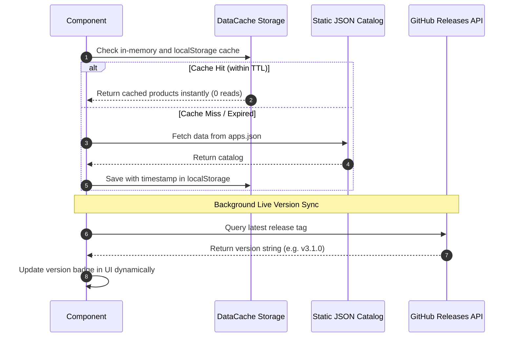
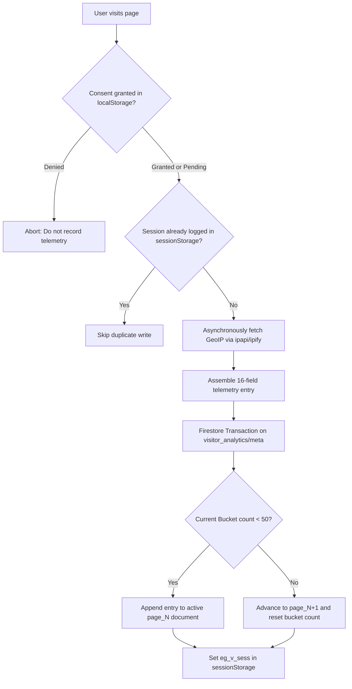

# Core Hooks & Services Documentation

This document covers the zero-read data caching architecture, 50-record batched telemetry bucket pattern, administrative 2FA security services, contact anti-spam processing, HTML sanitization, and modular Firebase SDK helpers in `eg-web-core`.

---

## 🔗 Source Files

| Service / Hook | File Path | Focus |
| :--- | :--- | :--- |
| **DataCache Service** | [`../src/services/DataCache.ts`](../src/services/DataCache.ts) | Static JSON fallback, local caching, GitHub version sync |
| **DataCache Hooks** | [`../src/hooks/useDataCache.ts`](../src/hooks/useDataCache.ts) | `useProducts`, `useNews`, `usePageContent`, `useDataCache` |
| **Visitor Tracker Service** | [`../src/services/visitorTracker.ts`](../src/services/visitorTracker.ts) | 50-record batched bucket telemetry, GeoIP, consent checking |
| **Visitor Tracker Hook** | [`../src/hooks/useVisitorTracker.ts`](../src/hooks/useVisitorTracker.ts) | Automatic route change tracking & session deduplication |
| **Admin Auth Service** | [`../src/services/adminAuthService.ts`](../src/services/adminAuthService.ts) | Google OAuth whitelist, SHA-256 PIN, lockout, audit logging |
| **Admin Auth Hook** | [`../src/hooks/useAdminAuth.ts`](../src/hooks/useAdminAuth.ts) | Reactive 2FA authentication state management hook |
| **Contact Service** | [`../src/services/contactService.ts`](../src/services/contactService.ts) | Math CAPTCHA, 24-hr rate limiting, Firestore `/messages` |
| **Updates Service** | [`../src/services/updatesService.ts`](../src/services/updatesService.ts) | Release notes fetcher, category filtering, caching |
| **useUpdates Hook** | [`../src/hooks/useUpdates.ts`](../src/hooks/useUpdates.ts) | Reactive updates & changelog hook |
| **useNotifications Hook** | [`../src/hooks/useNotifications.ts`](../src/hooks/useNotifications.ts) | Unread announcement badges and persistence |
| **Sanitizer Service** | [`../src/services/sanitizer.ts`](../src/services/sanitizer.ts) | Stored XSS defense (`sanitizeHtml`) and safe URL enforcer |
| **Firebase Services** | [`../src/services/firebase.ts`](../src/services/firebase.ts) | Modular SDK loading, `initFirebase`, `getFirestore`, `getFirebaseAuth` |
| **Firebase Context** | [`../src/theme/FirebaseContext.tsx`](../src/theme/FirebaseContext.tsx) | `FirebaseProvider` and `useFirebase()` hook |

---

## 1. ⚡ DataCache Architecture (Zero-Firestore-Read Strategy)

To eliminate cloud read costs and avoid Firestore quota exhaustion, static catalogs and copy are stored in lightweight static JSON files (`data/apps.json`, `data/website_content.json`) and cached in the browser's `localStorage` with TTL timestamps.



### 💻 DataCache Hooks Examples

```tsx
import React from 'react';
import { useProducts, useNews, usePageContent, useDataCache } from 'eg-web-core';

export function ProductsSection() {
  // 1. Fetch product items with automatic background GitHub version sync:
  const { products, loading, error, refresh } = useProducts('data/apps.json');

  // 2. Fetch news ticker announcements:
  const { news } = useNews('data/website_content.json');

  // 3. Fetch static website page content (e.g. about or privacy text):
  const { content: about } = usePageContent('about', 'data/website_content.json');

  // 4. Custom generic cache query:
  const { data: team } = useDataCache('team_members', 'data/team.json');

  if (loading) return <div>Loading software catalog...</div>;
  if (error) return <div>Error loading catalog: {error.message}</div>;

  return (
    <div>
      <h3>{about?.title || 'Our Software'}</h3>
      <button onClick={refresh}>Hard Refresh Catalog</button>
      <ul>
        {products.map((p) => (
          <li key={p.id}>
            <strong>{p.title}</strong> — v{p.version} ({p.category})
          </li>
        ))}
      </ul>
    </div>
  );
}
```

---

## 2. 🌐 Visitor Tracker & Telemetry (Batched Bucket Pattern)

The visitor telemetry system logs non-invasive analytics (GeoIP, OS, browser, screen resolution) into Firestore using the **Batched Bucket Pattern** (50 visitor sessions per document). This saves **98% of Firestore write quota**.



### 💻 `useVisitorTracker` Hook Usage

```tsx
import React from 'react';
import { useVisitorTracker } from 'eg-web-core';

export function AppRoot() {
  // Initializes telemetry tracking on route changes with session deduplication:
  useVisitorTracker({
    appName: 'eg1.in',
    collectionName: 'visitor_analytics',
  });

  return <div>My Website Content</div>;
}
```

---

## 3. 🛡️ Administrative Authentication & Lockout Defense (`adminAuthService`)

A hardened three-tier security infrastructure protecting administrative suites across the ecosystem:
1. **Tier 1 (Google OAuth Whitelist)**: Verifies identity via Google Sign-In and checks against `allowedEmails`.
2. **Tier 2 (16-Digit SHA-256 PIN)**: Requires a 16-digit numeric PIN ($10^{16}$ combinations) hashed with a secret salt using the Web Crypto API.
3. **Tier 3 (Lockout Defense & Logging)**: Tracks failed attempts per IP. Reaching 3 failures triggers a **24-hour lockout** in `admin_lockout/<sanitized_ip>`. Logs all attempts in `admin_login_log` (18 entries/doc).

### 💻 `useAdminAuth` Hook Usage

```tsx
import React, { useState } from 'react';
import { useAdminAuth } from 'eg-web-core';

export function AdminGate() {
  const {
    user,
    isPinVerified,
    isAuthenticated,
    isLoading,
    error,
    lockout,
    loginWithGoogle,
    verifyPin,
    logout,
  } = useAdminAuth({
    allowedEmails: ['admin@example.com'],
    pinSalt: 'YOUR_PIN_SALT_SECRET',
    maxFailAttempts: 3,
    lockoutDurationMs: 24 * 60 * 60 * 1000,
  });

  const [pin, setPin] = useState('');

  if (isLoading) return <div>Verifying credentials...</div>;

  if (lockout.locked) {
    return (
      <div style={{ color: '#ef4444' }}>
        Access blocked due to excessive failed attempts. Try again in {lockout.hoursRemaining} hour(s).
      </div>
    );
  }

  if (!user) {
    return (
      <div>
        {error && <p style={{ color: '#ef4444' }}>{error}</p>}
        <button onClick={() => loginWithGoogle()}>Sign in with Google</button>
      </div>
    );
  }

  if (!isPinVerified) {
    return (
      <div>
        <p>Logged in as: {user.email}</p>
        <input
          type="password"
          maxLength={16}
          value={pin}
          onChange={(e) => setPin(e.target.value)}
          placeholder="16-Digit PIN"
        />
        <button onClick={() => verifyPin(pin)}>Unlock Admin</button>
        <button onClick={() => logout()}>Switch User</button>
      </div>
    );
  }

  return (
    <div>
      <h1>Welcome, {user.email}</h1>
      <button onClick={() => logout()}>Sign Out</button>
    </div>
  );
}
```

---

## 4. 📬 Contact & Anti-Spam Services (`contactService`)

Provides anti-spam arithmetic challenges, 24-hour client rate limiting, Firestore persistence, and offline queueing for customer inquiries.

### 💻 Contact Helpers Usage

```ts
import {
  generateMathCaptcha,
  checkContactRateLimit,
  submitContactInquiry,
} from 'eg-web-core';

// 1. Generate an arithmetic challenge:
const challenge = generateMathCaptcha();
console.log(challenge.prompt);   // "What is 7 + 4?"
console.log(challenge.expected); // 11

// 2. Check client submission rate limit:
const rate = checkContactRateLimit('lastMessageTime', 24);
if (!rate.allowed) {
  console.warn(rate.message); // "You have already sent a message recently..."
}

// 3. Submit inquiry to Firestore /messages:
const result = await submitContactInquiry({
  name: 'John Doe',
  email: 'john@example.com',
  contact: '+1 555-0199',
  message: 'Inquiring about pyEGClamUI enterprise licensing.',
  appName: 'av.eg1.in',
});

if (result.success) {
  console.log('Submitted doc ID:', result.docId);
}
```

---

## 5. 🔔 Notifications & Changelogs (`useNotifications`, `useUpdates`)

Manages unread update counters and changelogs with persistence in `localStorage`.

```tsx
import React from 'react';
import { useNotifications, useUpdates, NotificationBell } from 'eg-web-core';

export function HeaderAnnouncements() {
  // Tracks unread announcement count:
  const { unreadCount, markAllAsRead } = useNotifications({
    storageKey: 'eg_notifications_seen',
    fetchUrl: 'data/website_content.json',
  });

  // Fetches changelog updates with category filters:
  const { updates, loading } = useUpdates('data/updates.json');

  return (
    <div style={{ display: 'flex', alignItems: 'center', gap: '12px' }}>
      <NotificationBell allUpdatesUrl="/updates.html" />
      <span>Unread: {unreadCount}</span>
      <button onClick={markAllAsRead}>Mark All as Read</button>
    </div>
  );
}
```

---

## 6. 🔒 Security & Sanitization Services (`sanitizer`)

Provides defense-in-depth protection against Cross-Site Scripting (XSS) and dangerous URL schemes.

```ts
import { sanitizeHtml, sanitizeUrl } from 'eg-web-core';

// 1. Prevent javascript: / data: / vbscript: URI attacks in links:
const safeHref = sanitizeUrl(untrustedUserLink, '#');

// 2. Sanitize HTML generated from Markdown to prevent Stored XSS:
const cleanHtml = sanitizeHtml(rawHtmlString);
```

---

## 7. 🔥 Modular Firebase SDK Helpers (`firebase.ts`, `FirebaseContext`)

Supports dynamically loading Firebase v10 compat SDK scripts on demand, avoiding upfront bundle bloat for users who don't visit auth or telemetry pages.

```tsx
import React from 'react';
import {
  FirebaseProvider,
  initFirebase,
  getFirestore,
  getFirebaseAuth,
  FirebaseAppConfig,
} from 'eg-web-core';

// Consumer supplies their own credentials:
const myFirebaseConfig: FirebaseAppConfig = {
  apiKey: 'AIzaSy...',
  authDomain: 'my-project.firebaseapp.com',
  projectId: 'my-project',
  appId: '1:12345:web:67890',
};

// Example A: React Context Wrapper with custom collections mapping
export function Root() {
  return (
    <FirebaseProvider
      config={myFirebaseConfig}
      appName="my-app"
      collections={{
        messages: 'inquiries',
        analytics: 'site_analytics',
      }}
    >
      <App />
    </FirebaseProvider>
  );
}

// Example B: Direct Asynchronous Helper
export async function queryCustomCollection() {
  const db = await getFirestore(myFirebaseConfig);
  const snap = await db.collection('custom_data').get();
  return snap.docs.map((d: any) => d.data());
}
```

