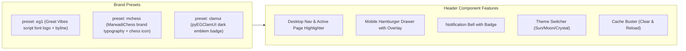

# Layout Components Documentation

This document covers the high-level layout systems and application shells that structure web pages across the EG web ecosystem.

---

## 🔗 Source Files

| Component | File Path | Focus |
| :--- | :--- | :--- |
| **Header** | [`../src/components/layout/Header.tsx`](../src/components/layout/Header.tsx) | Universal navigation header with presets and mobile drawer |
| **Footer** | [`../src/components/layout/Footer.tsx`](../src/components/layout/Footer.tsx) | Multi-column footer with dynamic about loader & socials |
| **Image Slider** | [`../src/components/layout/ImageSlider.tsx`](../src/components/layout/ImageSlider.tsx) | Crystal gradient hero banner with cross-fade transitions |
| **Layout Wrappers** | [`../src/components/layout/Container.tsx`](../src/components/layout/Container.tsx) | Container, Section, and PageHeader layout primitives |
| **Admin Layout** | [`../src/components/admin/AdminLayout.tsx`](../src/components/admin/AdminLayout.tsx) | Collapsible administrative shell with mobile drawer & header |

---

## 1. Universal `<Header />` Component

The universal header dynamically adapts to brand presets (`eg1`, `mchess`, `clamui`) or arbitrary custom navigation links. It includes a responsive desktop menu, mobile hamburger drawer, active page highlighter, and slots for [`<ThemeToggle />`](./ui-primitives.md), [`<NotificationBell />`](./ui-primitives.md), and [`<CacheBuster />`](./ui-primitives.md).



### 📋 Props Reference: `HeaderProps`

| Prop | Type | Default | Description |
| :--- | :--- | :--- | :--- |
| `preset` | `'eg1' \| 'mchess' \| 'clamui'` | `'eg1'` | Selects brand logo, fonts, and default navigation links |
| `navLinks` | `NavLinkItem[]` | `undefined` | Custom links array overriding the preset defaults |
| `githubUrl` | `string` | `'https://github.com/EG1DOTIN'` | Link for the GitHub corner button |
| `currentPath` | `string` | `'/'` | Current page URL path used to highlight the active menu item |
| `onNavigate` | `(href: string) => void` | `undefined` | Custom client-side router navigation callback |
| `showThemeToggle` | `boolean` | `true` | Toggles rendering of the `<ThemeToggle />` widget |
| `showNotificationBell` | `boolean` | `true` | Toggles rendering of the `<NotificationBell />` widget |
| `showCacheBuster` | `boolean` | `true` | Toggles rendering of the `<CacheBuster />` widget |
| `customLogo` | `React.ReactNode` | `undefined` | Custom logo element overriding preset logo |
| `extraControls` | `React.ReactNode` | `undefined` | Custom action buttons injected into header controls slot |

### 💻 Header Example

```tsx
import React from 'react';
import { Header } from 'eg-web-core';

export function NavigationBar() {
  return (
    <Header
      preset="eg1"
      currentPath="/apps.html"
      onNavigate={(href) => {
        console.log('Navigating to:', href);
      }}
      extraControls={
        <a
          href="/admin"
          style={{
            fontSize: '0.8125rem',
            padding: '4px 10px',
            borderRadius: '6px',
            background: 'rgba(16, 185, 129, 0.12)',
            color: 'var(--eg-color-primary, #10b981)',
            textDecoration: 'none',
            fontWeight: 600,
          }}
        >
          Admin
        </a>
      }
    />
  );
}
```

---

## 2. Universal `<Footer />` Component

The universal footer renders brand information, an asynchronous about snippet fetched via `DataCache` (with fallback), multi-column navigation links, social media icons, and copyright attribution.

### 📋 Props Reference: `FooterProps`

| Prop | Type | Default | Description |
| :--- | :--- | :--- | :--- |
| `preset` | `'eg1' \| 'mchess' \| 'clamui'` | `'eg1'` | Selects brand logo and default navigation link columns |
| `aboutText` | `string` | Dynamic | Static about blurb. If omitted, dynamically fetched via `DataCache` |
| `sections` | `FooterSection[]` | `undefined` | Custom multi-column navigation sections |
| `copyrightText` | `string` | Current Year | Bottom copyright disclaimer |
| `socialLinks` | `SocialLinksConfig` | `undefined` | Custom social media profile URLs |
| `newsletterSlot` | `React.ReactNode` | `undefined` | Optional slot for newsletter subscription input |

### 💻 Footer Example

```tsx
import React from 'react';
import { Footer } from 'eg-web-core';

export function PageFooter() {
  return (
    <Footer
      preset="eg1"
      copyrightText="© 2026 EG1 Ecosystem. Free and Open Source Software."
      sections={[
        {
          title: 'Applications',
          links: [
            { label: 'Marwadi Chess', href: 'https://mchess.eg1.in' },
            { label: 'pyEGClamUI', href: 'https://av.eg1.in' },
          ],
        },
        {
          title: 'Resources',
          links: [
            { label: 'Blog & Tutorials', href: '/blog.html' },
            { label: 'Documentation', href: '/docs.html' },
            { label: 'Privacy Policy', href: '/privacypolicy.html' },
          ],
        },
      ]}
    />
  );
}
```

---

## 3. `<ImageSlider />` Component

Hero banner displaying cross-fading crystal theme gradient transitions (`crystal-theme-1` to `crystal-theme-6`), responsive typography, slide badges, and call-to-action buttons.

### 📋 Props Reference: `ImageSliderProps`

| Prop | Type | Default | Description |
| :--- | :--- | :--- | :--- |
| `slides` | `SlideItem[]` | Default 3 slides | Array of slide items containing title, subtitle, CTA, and crystal gradient |
| `intervalMs` | `number` | `5000` | Auto-advance interval in milliseconds |
| `autoPlay` | `boolean` | `true` | Enables or disables automated slide transitions |
| `showIndicators` | `boolean` | `true` | Bottom dot indicator navigation buttons |
| `showArrows` | `boolean` | `true` | Previous and next slide arrow buttons |
| `height` | `string` | `'480px'` | Height constraint of the hero slider |

### 💻 ImageSlider Example

```tsx
import React from 'react';
import { ImageSlider } from 'eg-web-core';

export function HeroBanner() {
  return (
    <ImageSlider
      intervalMs={6000}
      height="450px"
      slides={[
        {
          title: 'Free & Open Source Software',
          subtitle: 'Clean desktop applications, developer utilities, and web engines.',
          badge: '2026 Releases',
          buttonLabel: 'Explore All Apps',
          buttonHref: '/apps.html',
          crystalThemeIndex: 1,
        },
        {
          title: 'Multiplayer P2P & Engine Chess',
          subtitle: 'Play against Stockfish 10 AI with 20 difficulty levels and daily puzzles.',
          badge: 'Play Online',
          buttonLabel: 'Launch Marwadi Chess',
          buttonHref: 'https://mchess.eg1.in',
          crystalThemeIndex: 2,
        },
      ]}
    />
  );
}
```

---

## 4. `<Container />`, `<Section />`, `<PageHeader />`

Layout wrappers providing standardized padding, responsive clamp max-widths, and consistent heading structures across all consumer portals.

### 📋 Components Reference

#### `<Container />`
- `wide?: boolean` — Expands max-width to `min(1680px, 96%)` (`--eg-container-wide`) for widescreen portals and technical documentation.
- `narrow?: boolean` — Restricts max-width to `880px` (`--eg-container-narrow`) for focused readable articles and forms.
- `fluid?: boolean` — Sets max-width to `100%` for edge-to-edge fluid layouts.
- Default max-width: `min(1536px, 94%)` (`--eg-container-max`) with fluid responsive padding `clamp(16px, 2.5vw, 32px)`.
- `className?: string` — Extra CSS class names.
- `style?: React.CSSProperties` — Inline styles.

#### `<Section />`
- `padded?: boolean` — Applies vertical spacing (`--eg-space-12`, `3rem`).
- `background?: 'primary' | 'secondary' | 'canvas'` — Background color tokens.

#### `<PageHeader />`
- `title: string` — Main page `<h1>` heading.
- `badge?: string` — Small colored status/category badge above the title.
- `subtitle?: string` — Explanatory paragraph below the title.
- `centered?: boolean` — Center-aligns title and text (default: `true`).

### 💻 Layout Wrappers Example

```tsx
import React from 'react';
import { Container, Section, PageHeader } from 'eg-web-core';

export function CatalogPage() {
  return (
    <main>
      <Section padded>
        <Container narrow={false}>
          <PageHeader
            badge="Software Catalog"
            title="All Desktop Software & Web Tools"
            subtitle="Explore our fast, modern, and open-source releases."
            centered={true}
          />

          <div style={{ marginTop: '32px' }}>
            {/* Products grid content */}
          </div>
        </Container>
      </Section>
    </main>
  );
}
```

---

## 5. `<AdminLayout />` Component

The master shell for administrative consoles and management dashboards. It incorporates a collapsible desktop sidebar, slide-out mobile drawer with backdrop overlay, sticky header with dynamic title, user profile pill, theme toggle, and sign-out button.

For complete documentation, props tables, and diagrams, see the **[Admin Suite Documentation](./admin-suite.md#5-adminlayout)**.
