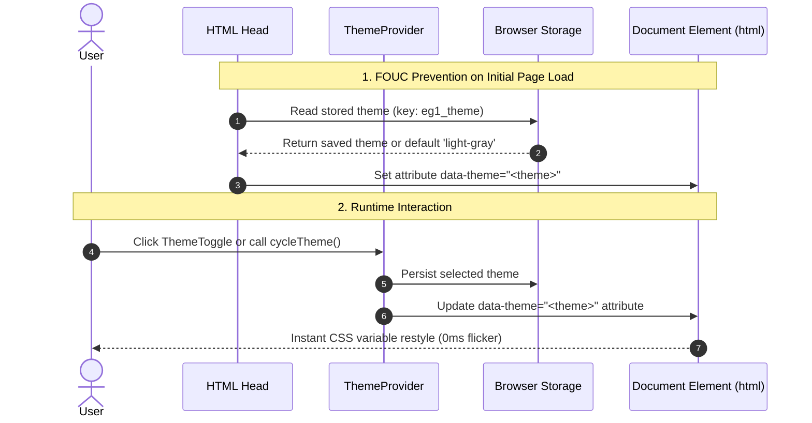

# Design Tokens & Theming Engine

The **EG-Web-Core Theming Engine** provides zero-overhead, highly performant CSS custom properties and dynamic React context providers that unify colors, typography scales, elevation shadows, border radii, and transitions across all EG web applications.

---

## 🔗 Source Files

| Component / Token File | File Path | Focus |
| :--- | :--- | :--- |
| **CSS Design Tokens** | [`../src/tokens/tokens.css`](../src/tokens/tokens.css) | All CSS custom properties, color palettes, and fonts |
| **Theme Context & Provider** | [`../src/theme/ThemeContext.tsx`](../src/theme/ThemeContext.tsx) | `ThemeProvider`, `useTheme()`, and FOUC prevention helper |
| **Theme Exports** | [`../src/theme/index.ts`](../src/theme/index.ts) | Barrel export for theming utilities |

---

## 🔄 Theme Lifecycle & Synchronization Flow



---

## 🎨 Supported Themes & Aesthetic Profiles

| Theme Name | `data-theme` Value | Surface Color | Canvas Background | Aesthetic Profile |
| :--- | :--- | :--- | :--- | :--- |
| **Light Gray** *(Default)* | `data-theme="light-gray"` | `#ffffff` | `#f8fafc` | Clean, crisp, high-readability daylight mode. |
| **Dark** | `data-theme="dark"` | `#111827` | `#030712` | Deep navy-slate dark mode for EG1 and MChess. |
| **pyEGClamUI Dark** | `data-theme="clamui-dark"` | `#15151c` | `#0b0b0e` | Authoritative Qt/ClamAV developer dark with emerald accents. |
| **Crystal Gradient** | `data-theme="crystal"` | `rgba(17, 24, 39, 0.85)` | `#030712` | Glassmorphic gradient backdrops with 6 rotating crystal accents. |

---

## 📋 Design Tokens Reference

All design tokens are defined in [`tokens.css`](../src/tokens/tokens.css) and are directly available in CSS or React inline styles:

### 1. Typography Scales & Fonts
```css
/* Fonts */
--eg-font-sans: 'Plus Jakarta Sans', 'Inter', -apple-system, sans-serif;
--eg-font-mono: 'JetBrains Mono', 'Fira Code', monospace;
--eg-font-brand: var(--eg-font-sans);

/* Fluid Typography Scale (using clamp) */
--eg-text-xs: clamp(0.75rem, 0.7rem + 0.25vw, 0.8125rem);
--eg-text-sm: clamp(0.8125rem, 0.78rem + 0.2vw, 0.875rem);
--eg-text-base: clamp(0.9375rem, 0.9rem + 0.2vw, 1rem);
--eg-text-lg: clamp(1.0625rem, 1rem + 0.35vw, 1.125rem);
--eg-text-xl: clamp(1.25rem, 1.15rem + 0.5vw, 1.375rem);
--eg-text-2xl: clamp(1.5rem, 1.35rem + 0.75vw, 1.75rem);
--eg-text-3xl: clamp(1.875rem, 1.6rem + 1.2vw, 2.25rem);
--eg-text-4xl: clamp(2.25rem, 1.85rem + 1.8vw, 2.875rem);
```

### 2. Spacing Scale
```css
--eg-space-1: 0.25rem;  /* 4px */
--eg-space-2: 0.5rem;   /* 8px */
--eg-space-3: 0.75rem;  /* 12px */
--eg-space-4: 1rem;     /* 16px */
--eg-space-5: 1.25rem;  /* 20px */
--eg-space-6: 1.5rem;   /* 24px */
--eg-space-8: 2rem;     /* 32px */
--eg-space-10: 2.5rem;  /* 40px */
--eg-space-12: 3rem;    /* 48px */
--eg-space-16: 4rem;    /* 64px */
```

### 3. Border Radii & Transitions
```css
--eg-radius-xs: 4px;
--eg-radius-sm: 6px;
--eg-radius-md: 10px;
--eg-radius-lg: 14px;
--eg-radius-xl: 20px;
--eg-radius-pill: 9999px;

--eg-transition-fast: 150ms cubic-bezier(0.4, 0, 0.2, 1);
--eg-transition-normal: 220ms cubic-bezier(0.4, 0, 0.2, 1);
--eg-transition-slow: 350ms cubic-bezier(0.4, 0, 0.2, 1);
```

### 4. Semantic Color Tokens
```css
/* Brand Accents */
--eg-color-primary: #10b981;          /* Emerald Green */
--eg-color-primary-hover: #059669;
--eg-color-emerald: #00dc82;
--eg-color-emerald-glow: rgba(0, 220, 130, 0.16);
--eg-color-sky: #38bdf8;              /* Sky Blue */
--eg-color-indigo: #6366f1;           /* Indigo Accent */
--eg-color-amber: #f59e0b;            /* Warning / Amber */
--eg-color-crimson: #ef4444;          /* Danger / Crimson */

/* Dynamic Theme Surfaces (Restyles automatically on theme switch) */
--eg-bg-primary: #ffffff;             /* Primary card background */
--eg-bg-secondary: #f8fafc;           /* Section / elevated surface */
--eg-bg-tertiary: #f1f5f9;            /* Button / input background */
--eg-border: rgba(0, 0, 0, 0.08);     /* Neutral border stroke */
--eg-text-primary: #0f172a;           /* Headings and primary copy */
--eg-text-secondary: #475569;         /* Descriptions and subtitles */
--eg-text-muted: #94a3b8;             /* Timestamps and footnotes */
```

---

## 💻 React Integration: `<ThemeProvider />` & `useTheme()`

### 1. Wrapping Application Root
```tsx
import React from 'react';
import { ThemeProvider, Header, Footer } from 'eg-web-core';
import 'eg-web-core/style.css';

export function App() {
  return (
    <ThemeProvider defaultTheme="light-gray" storageKey="eg1_theme">
      <Header preset="eg1" />
      <main>
        {/* Your application views */}
      </main>
      <Footer preset="eg1" />
    </ThemeProvider>
  );
}
```

### 2. Consuming the `useTheme()` Hook
```tsx
import React from 'react';
import { useTheme, ThemeToggle } from 'eg-web-core';

export function ThemeBar() {
  const { theme, setTheme, cycleTheme, isDark } = useTheme();

  return (
    <div style={{ display: 'flex', alignItems: 'center', gap: '12px' }}>
      <span>Current Mode: {theme} ({isDark ? 'Dark' : 'Light'})</span>
      <ThemeToggle size="md" showLabel={true} />
      <button onClick={() => setTheme('dark')}>Force Dark</button>
      <button onClick={cycleTheme}>Next Theme</button>
    </div>
  );
}
```

---

## ⚡ FOUC (Flash of Unstyled Content) Prevention

In SSR environments (Next.js) or static HTML portals, insert this inline script in `<head>` before body hydration to set the `data-theme` attribute synchronously:

```html
<script>
  (function() {
    try {
      var saved = localStorage.getItem('eg1_theme') || 'light-gray';
      document.documentElement.setAttribute('data-theme', saved);
    } catch(e) {}
  })();
</script>
```

Alternatively, import the pre-built helper string from `eg-web-core`:
```tsx
import { getFoucPreventScript } from 'eg-web-core';

export function Head() {
  return (
    <head>
      <script dangerouslySetInnerHTML={{ __html: getFoucPreventScript() }} />
    </head>
  );
}
```
