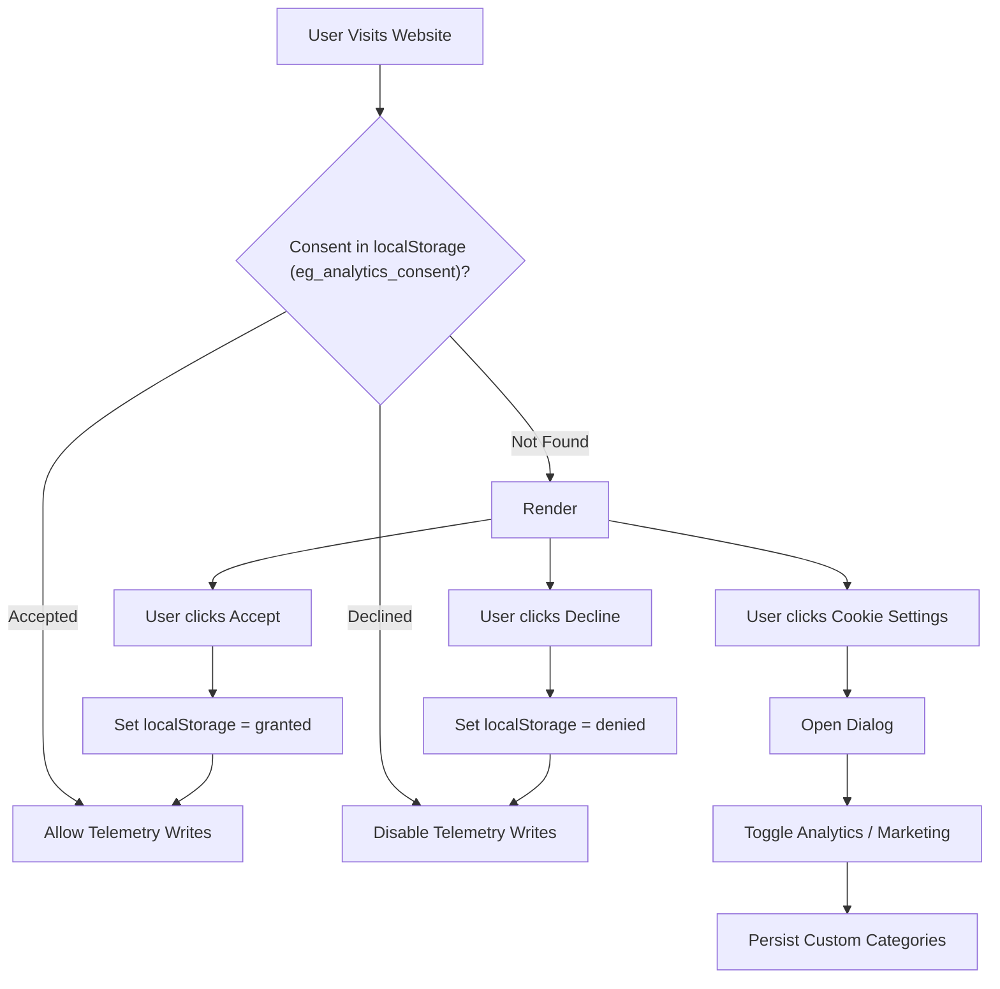

# UI Primitives & Interactive Widgets Documentation

This document describes the atomic UI components, interactive widgets, privacy consent controls, and procedural SVG icon systems provided by `eg-web-core`.

---

## 🔗 Source Files

| Component | File Path | Focus |
| :--- | :--- | :--- |
| **Theme Toggle** | [`../src/components/common/ThemeToggle.tsx`](../src/components/common/ThemeToggle.tsx) | Theme cycle switch (light, dark, crystal) |
| **Notification Bell** | [`../src/components/common/NotificationBell.tsx`](../src/components/common/NotificationBell.tsx) | Header bell trigger, unread badge, and dropdown |
| **Cache Buster** | [`../src/components/common/CacheBuster.tsx`](../src/components/common/CacheBuster.tsx) | Hard-reload & Service Worker / CacheStorage cleaner |
| **Accessible Modal** | [`../src/components/common/Modal.tsx`](../src/components/common/Modal.tsx) | Accessible dialog popup with backdrop blur & ESC exit |
| **Share Modal** | [`../src/components/common/ShareModal.tsx`](../src/components/common/ShareModal.tsx) | Multi-platform social sharing dialog & link copier |
| **Totem News Ticker** | [`../src/components/common/TotemTicker.tsx`](../src/components/common/TotemTicker.tsx) | Vertical sliding news announcement ticker |
| **Smart Scroll Button** | [`../src/components/common/SmartScrollButton.tsx`](../src/components/common/SmartScrollButton.tsx) | Scroll-to-top / bottom with circular progress ring |
| **Consent Banner** | [`../src/components/common/ConsentBanner.tsx`](../src/components/common/ConsentBanner.tsx) | GDPR privacy consent banner with accept/decline |
| **Consent Control** | [`../src/components/common/ConsentControl.tsx`](../src/components/common/ConsentControl.tsx) | Fine-grained telemetry & cookie category preferences modal |
| **Logo** | [`../src/components/common/Logo.tsx`](../src/components/common/Logo.tsx) | Generic website logo with preset brand typography |
| **Social Icons** | [`../src/components/common/SocialIcons.tsx`](../src/components/common/SocialIcons.tsx) | Safe external social profile link icons with SVG |
| **Icons Library** | [`../src/components/common/Icons.tsx`](../src/components/common/Icons.tsx) | Procedural zero-dependency SVG vector icon helpers |
| **Button** | [`../src/components/common/Button.tsx`](../src/components/common/Button.tsx) | Micro-animated multi-variant button |
| **Badge** | [`../src/components/common/Badge.tsx`](../src/components/common/Badge.tsx) | Pill badges for tags, versions, and categories |

---

## 1. Component Overview & Capabilities

| Component | Purpose | Key Props & Features |
| :--- | :--- | :--- |
| `<ThemeToggle />` | Switch between light, dark, and crystal themes. | `size` (`'sm'`, `'md'`, `'lg'`), `showLabel`. Animated procedural SVGs. |
| `<NotificationBell />` | Announcements trigger with unread counter badge. | `storageKey`, `fetchUrl`, `allUpdatesUrl`. Interactive dropdown drawer. |
| `<CacheBuster />` | Purges service workers, CacheStorage, and resets in-memory data. | `size`, `showLabel`, `onRefreshComplete`. Hard-reload button. |
| `<Modal />` | Accessible popup dialog with backdrop blur. | `isOpen`, `onClose`, `title`, `maxWidth`, `footer`. ESC key and focus lock. |
| `<ShareModal />` | Share dialog with copy link and social buttons. | `isOpen`, `onClose`, `title`, `url`, `description`. WhatsApp, X, LinkedIn, Telegram. |
| `<TotemTicker />` | Smooth vertical news announcement ticker. | `items`, `intervalMs`, `label`. Pause-on-hover, prev/next arrows. |
| `<SmartScrollButton />`| Scroll-to-top / bottom with progress ring. | `threshold`, `size`, `color`, `position`. Auto-detects bottom of page. |
| `<ConsentBanner />` | Non-intrusive GDPR telemetry consent banner. | `onAccept`, `onDecline`, `storageKey`, `privacyPolicyUrl`. Slide-in banner. |
| `<ConsentControl />`| Modal dialog for fine-grained privacy settings. | `isOpen`, `onClose`. Categorized toggles (Essential, Analytics, Marketing). |
| `<Logo />` | Flexible brand logo component with presets. | `preset` (`'eg1'`, `'mchess'`, `'clamui'`), `title`, `byline`, `icon`. |
| `<SocialIcons />` | Social link icon cluster with security protection. | `githubUrl`, `xUrl`, `linkedinUrl`, `youtubeUrl`, `email`. Safe `rel` attributes. |
| `<Button />` | Polished button with micro-animations. | `variant` (`'primary'`, `'secondary'`, `'outline'`, `'danger'`), `size`, `loading`. |
| `<Badge />` | Status indicators and tag pills. | `variant` (`'primary'`, `'success'`, `'warning'`, `'danger'`, `'neutral'`), `size`. |

---

## 2. Interactive Widget Details & Usages

### 🔘 Buttons & Badges
Buttons and badges utilize design tokens and include subtle elevation and hover transitions:

```tsx
import React from 'react';
import { Button, Badge } from 'eg-web-core';

export function PrimitivesDemo() {
  return (
    <div style={{ display: 'flex', gap: '10px', alignItems: 'center', flexWrap: 'wrap' }}>
      <Button variant="primary" size="md">Download Installer</Button>
      <Button variant="secondary" size="md">View Source</Button>
      <Button variant="outline" size="sm">Documentation</Button>
      <Button variant="danger" size="sm">Delete</Button>

      <Badge variant="success">Active</Badge>
      <Badge variant="warning">Beta v2.0</Badge>
      <Badge variant="primary">v1.4.2</Badge>
      <Badge variant="neutral">Documentation</Badge>
    </div>
  );
}
```

#### `<Button />` Props
| Prop | Type | Default | Description |
| :--- | :--- | :--- | :--- |
| `variant` | `'primary' \| 'secondary' \| 'outline' \| 'danger'` | `'primary'` | Visual style variant |
| `size` | `'sm' \| 'md' \| 'lg'` | `'md'` | Padding and font scale |
| `loading` | `boolean` | `false` | Displays loading spinner and disables clicks |
| `disabled` | `boolean` | `false` | Standard HTML disabled state |
| `onClick` | `(e: React.MouseEvent) => void` | `undefined` | Click event handler |

---

### 🚀 Smart Scroll Button (`<SmartScrollButton />`)
A floating button that calculates vertical scroll depth, displays a circular SVG progress indicator, and smoothly scrolls to top (or to bottom when near top).

```tsx
import React from 'react';
import { SmartScrollButton } from 'eg-web-core';

export function LayoutWithScroll() {
  return (
    <div>
      {/* Page content */}
      <SmartScrollButton
        threshold={250}
        size={46}
        color="var(--eg-color-primary, #10b981)"
        position="bottom-right"
      />
    </div>
  );
}
```

#### Props Reference: `SmartScrollButtonProps`
| Prop | Type | Default | Description |
| :--- | :--- | :--- | :--- |
| `threshold` | `number` | `300` | Pixels scrolled before the button appears |
| `size` | `number` | `44` | Diameter of the floating button in pixels |
| `color` | `string` | `'var(--eg-color-primary)'` | Accent color for the SVG progress ring |
| `position` | `'bottom-right' \| 'bottom-left'` | `'bottom-right'` | Screen docking position |

---

### 🛡️ Privacy Consent Banner & Controls (`<ConsentBanner />`, `<ConsentControl />`)
Complies with GDPR and privacy directives by requiring user consent before executing Firestore telemetry writes.



```tsx
import React, { useState } from 'react';
import { ConsentBanner, ConsentControl, Button } from 'eg-web-core';

export function PrivacyWrapper() {
  const [showSettings, setShowSettings] = useState(false);

  return (
    <>
      {/* Non-intrusive floating banner */}
      <ConsentBanner
        storageKey="eg_analytics_consent"
        privacyPolicyUrl="/privacypolicy.html"
        onOpenSettings={() => setShowSettings(true)}
      />

      {/* Comprehensive settings modal */}
      <ConsentControl
        isOpen={showSettings}
        onClose={() => setShowSettings(false)}
        storageKey="eg_analytics_consent"
      />

      {/* Footer trigger button for users to change preferences later */}
      <Button variant="outline" size="sm" onClick={() => setShowSettings(true)}>
        Cookie Preferences
      </Button>
    </>
  );
}
```

---

### 🪟 Accessible Dialog Modal (`<Modal />`)
Accessible popup modal featuring background blur, backdrop dismiss, ESC key handler, and animated scale transitions:

```tsx
import React, { useState } from 'react';
import { Modal, Button } from 'eg-web-core';

export function AppDetailModal() {
  const [isOpen, setIsOpen] = useState(false);

  return (
    <>
      <Button onClick={() => setIsOpen(true)}>View Release Notes</Button>
      <Modal
        isOpen={isOpen}
        onClose={() => setIsOpen(false)}
        title="pyEGClamUI v3.1.0"
        maxWidth="600px"
        footer={
          <div style={{ display: 'flex', justifyContent: 'flex-end', gap: '8px' }}>
            <Button variant="secondary" onClick={() => setIsOpen(false)}>Close</Button>
            <Button variant="primary" onClick={() => alert('Downloading...')}>Download</Button>
          </div>
        }
      >
        <p>This release introduces multi-core archive decompression and instant heuristics.</p>
      </Modal>
    </>
  );
}
```

---

### 📤 Social Share Modal (`<ShareModal />`)
Social sharing dialog with one-click link copying and direct sharing to WhatsApp, X (Twitter), LinkedIn, and Telegram:

```tsx
import React, { useState } from 'react';
import { ShareModal, Button } from 'eg-web-core';

export function ShareArticleButton() {
  const [open, setOpen] = useState(false);

  return (
    <>
      <Button variant="outline" onClick={() => setOpen(true)}>Share Post</Button>
      <ShareModal
        isOpen={open}
        onClose={() => setOpen(false)}
        title="Modern Cloud Architecture with React"
        url="https://eg1.in/blog.html?id=cloud-architecture"
        description="Comprehensive tutorial on building high-performance web systems."
      />
    </>
  );
}
```

---

### 📰 Totem News Announcement Ticker (`<TotemTicker />`)
Vertical ticker displaying rolling announcements, updates, or blog highlights with pause-on-hover and manual navigation:

```tsx
import React from 'react';
import { TotemTicker } from 'eg-web-core';

const announcements = [
  { id: '1', title: 'Marwadi Chess v1.4 Released with Stockfish 10 Engine', link: '/updates.html' },
  { id: '2', title: 'pyEGClamUI 3.1.0: Qt6 Modernized Antivirus UI', link: '/updates.html' },
  { id: '3', title: 'New Tutorial: Asynchronous Data Caching Strategies', link: '/blog.html' },
];

export function BannerTicker() {
  return (
    <TotemTicker
      items={announcements}
      intervalMs={4500}
      label="Latest Updates"
    />
  );
}
```

---

### 🏷️ Website Branding Logo (`<Logo />`)
Website-agnostic logo component supporting brand presets (`eg1`, `mchess`, `clamui`) and arbitrary custom logos:

```tsx
import React from 'react';
import { Logo } from 'eg-web-core';

export function BrandHeader() {
  return (
    <div style={{ display: 'flex', gap: '20px' }}>
      {/* Preset logo with brand styling */}
      <Logo preset="eg1" />

      {/* Fully custom logo */}
      <Logo
        title="MyCustomApp"
        byline="Developer Tools"
        icon={<span>⚡</span>}
        href="/"
      />
    </div>
  );
}
```

---

### 🌐 Social Icons Cluster (`<SocialIcons />`)
Accessible external links with verified security attributes (`rel="noopener noreferrer"`) and procedural SVGs:

```tsx
import React from 'react';
import { SocialIcons } from 'eg-web-core';

export function FooterSocials() {
  return (
    <SocialIcons
      githubUrl="https://github.com/EG1DOTIN"
      xUrl="https://x.com/EG1DOTIN"
      linkedinUrl="https://linkedin.com/company/eg1"
      youtubeUrl="https://youtube.com/@EG1DOTIN"
      email="contact@example.com"
      size={20}
    />
  );
}
```

---

### 🎨 Procedural SVG Icons Library (`Icons.tsx`)
Zero-dependency, scalable SVG vector helpers designed for high-density displays:

```tsx
import React from 'react';
import {
  SunIcon,
  MoonIcon,
  CrystalIcon,
  SearchIcon,
  CopyIcon,
  CheckIcon,
  LockIcon,
  ShieldIcon,
  ArrowUpIcon,
  ExternalLinkIcon,
} from 'eg-web-core';

export function IconsShowcase() {
  return (
    <div style={{ display: 'flex', gap: '12px', alignItems: 'center' }}>
      <SunIcon size={20} color="#f59e0b" />
      <MoonIcon size={20} color="#38bdf8" />
      <CrystalIcon size={20} color="#a855f7" />
      <SearchIcon size={18} />
      <LockIcon size={18} />
      <ShieldIcon size={18} color="#10b981" />
      <CopyIcon size={16} />
      <CheckIcon size={16} color="#10b981" />
      <ArrowUpIcon size={16} />
      <ExternalLinkIcon size={14} />
    </div>
  );
}
```
