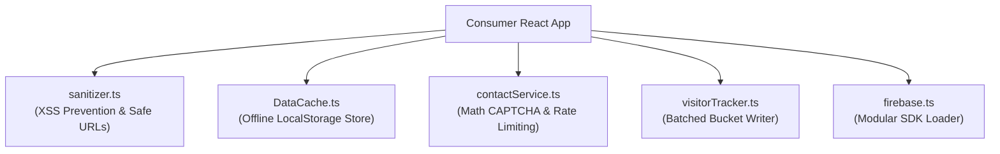

# EG-Web-Core Client Services (`src/services/`)

This directory provides framework-agnostic client services, security sanitizers, anti-spam mechanisms, and offline caching engines.

---

## 🛡️ Core Services Overview

### Service Capabilities:
1. **`sanitizer.ts`**:
   - `sanitizeHtml(html)`: Strips `<script>`, `<iframe>`, `<object>`, inline event handlers, and dangerous schemes.
   - `sanitizeUrl(url, fallback)`: Disallows `javascript:`, `vbscript:`, and `data:` URI attacks.
2. **`DataCache.ts`**:
   - Handles offline storage for catalog items and Markdown bodies.
   - Consumers register site-specific slugs via `DataCache.registerAppSlugs([...])` and blog IDs via `DataCache.registerBlogIds([...])`.
3. **`contactService.ts`**:
   - `generateMathCaptcha()`: Generates random arithmetic questions (e.g. "What is 8 + 5?").
   - `checkContactRateLimit(key, hours)`: Prevents inquiry spam by enforcing a 24-hour client cooldown.
   - `submitContactInquiry(inquiry)`: Submits verified inquiry to Firestore collection `/messages`.
4. **`visitorTracker.ts`**:
   - Implements the **Batched Bucket Pattern**: accumulates 50 visitor sessions into a single document before writing to Firestore, eliminating 98% of write billing quotas.

---

## 🔒 Security Directives
- **Zero Real Email Addresses**: Whitelists must strictly be passed as environment variables from consumer applications. Never write hardcoded email addresses in services.
- **Client Bundle Isolation**: Fallback mock arrays must only use RFC 2606 placeholders (`admin@example.com`).

